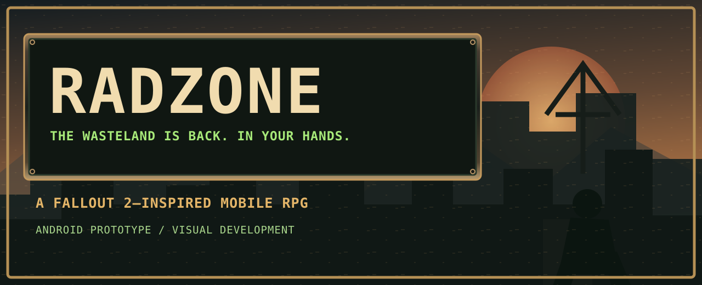
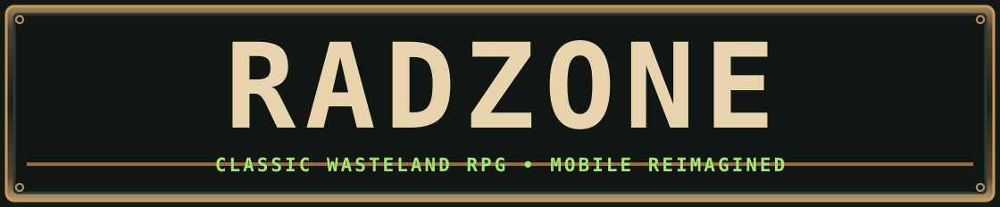
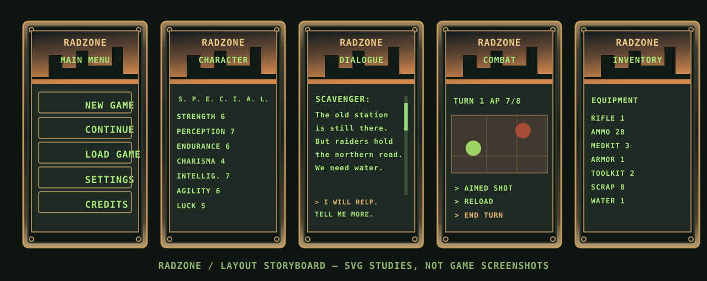

[EN](./README.md) · [RU](./README.ru.md) · [ES](./README.es.md) · [DE](./README.de.md) · [FR](./README.fr.md)

   

# RADZONE
**Klassische RPG-Seele. Moderne Ödnis.**

**RADZONE** ist ein postapokalyptisches Mobile-Rollenspiel für Fans von **Fallout 2**. Geplant sind die vertrauten SPECIAL-Attribute, rundenbasierte Kämpfe, Aktionspunkte, lange Dialoge und klassische Rollenspieltiefe.

## Visuelle Ausrichtung

Die freigegebene Gestaltung verbindet realistische isometrische Ödniswelten mit abgenutztem Metall, mechanischen Tasten, bernsteinfarbenen Signalleuchten und grünem CRT-Text. Der frühere Arbeitstitel REBORN MOBILE wurde durch **RADZONE** ersetzt. Zehn vollständige Konzeptbilder sind für den GitHub-Upload vorbereitet.

> Die Vektorgrafik ist eine Layoutstudie, kein echter Spiel-Screenshot. Auch die freigegebenen Motive sind Konzeptkunst.

## Entwicklungsstand

Das Projekt ist ein Android-Prototyp mit Godot 4.7.2. OpenCode integriert Engine-Code und Grafikkomponenten; die Produktion läuft.

[Art direction](./docs/ART_DIRECTION_RADZONE.md) · [Project state](./PROJECT_STATE.md) · [Asset handoff](./docs/RADZONE_OPENCODE_HANDOFF.md)

`git clone https://github.com/rf24kja/Fallout-mobile.git`
