
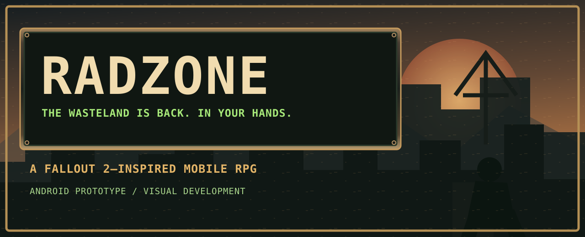

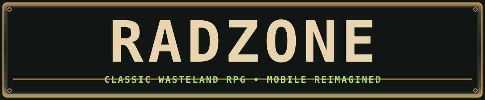

[EN](./README.md) · [RU](./README.ru.md) · [ES](./README.es.md) · [DE](./README.de.md) · [FR](./README.fr.md)

   

# RADZONE
**El alma del RPG clásico. Un yermo moderno.**

**RADZONE** es un RPG móvil posapocalíptico creado para los aficionados de **Fallout 2**: SPECIAL, combate táctico, puntos de acción, diálogos largos y libertad de juego en un mundo devastado.

## Nuevo: biblioteca de recursos gráficos

Ilustraciones SVG originales, editables y con fondo transparente (aún en desarrollo):

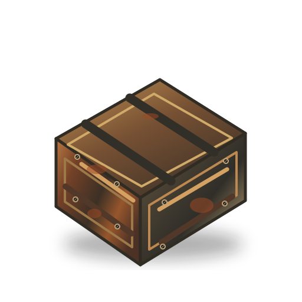
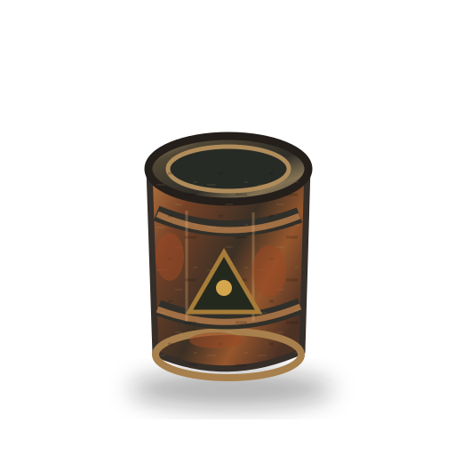
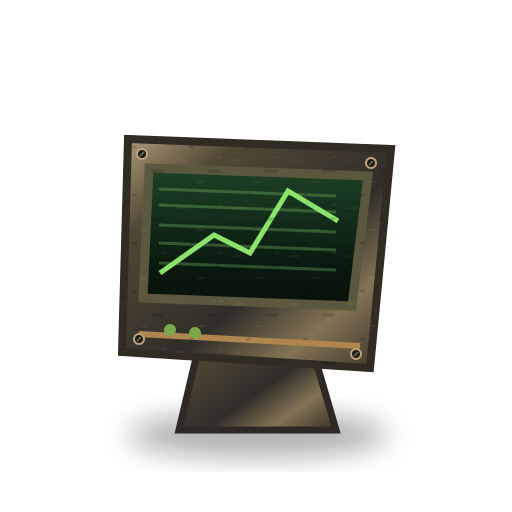
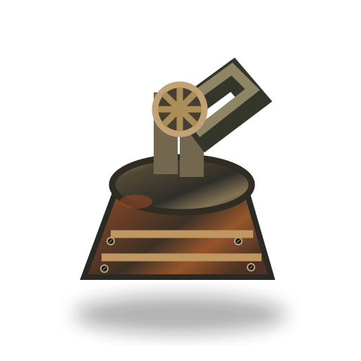

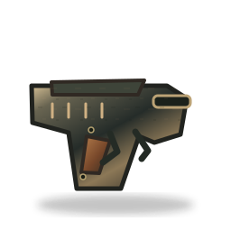
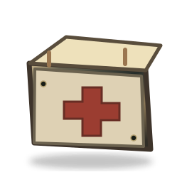
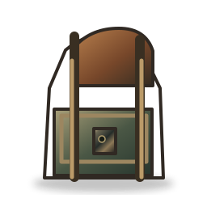
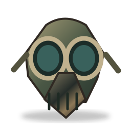
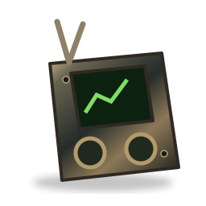

[Browse all production sources](./art/production/README.md) · [Manifest](./docs/RADZONE_ART_SOURCE_MANIFEST.json)

## Dirección artística

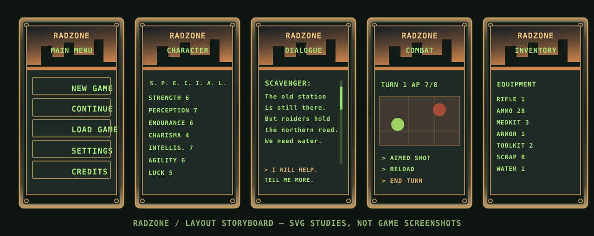

La dirección aprobada une entornos isométricos realistas con paneles metálicos envejecidos, botones mecánicos, luces ámbar y pantallas de fósforo verde. El título anterior, REBORN MOBILE, pasa a llamarse **RADZONE**. Las diez ilustraciones completas están preparadas para subir a GitHub.

> El diagrama vectorial no es una captura del juego; las imágenes aprobadas son arte conceptual, no capturas de una versión jugable.

## Desarrollo

El proyecto es un prototipo Android en Godot 4.7.2. OpenCode integra la lógica y los gráficos; el arte final sigue en desarrollo.

[Art direction](./docs/ART_DIRECTION_RADZONE.md) · [Project state](./PROJECT_STATE.md) · [Asset handoff](./docs/RADZONE_OPENCODE_HANDOFF.md)

`git clone https://github.com/rf24kja/Fallout-mobile.git`
