
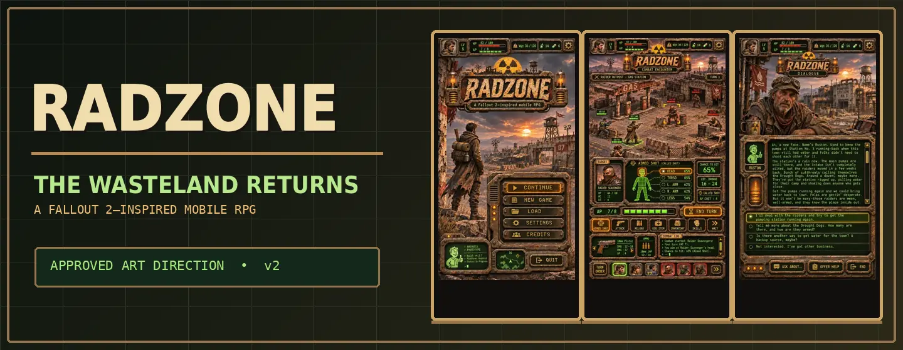

<a href="./README.md">English</a> &nbsp;·&nbsp; <a href="./README.ru.md">Русский</a> &nbsp;·&nbsp; <a href="./README.es.md">Español</a> &nbsp;·&nbsp; <a href="./README.de.md">Deutsch</a> &nbsp;·&nbsp; <a href="./README.fr.md">Français</a>

# RADZONE

<strong>Un RPG mobile post-apocalyptique pensé pour les fans de Fallout 2.</strong>

**La profondeur du RPG classique avec de nouveaux graphismes et des commandes tactiles.** RADZONE vise à préserver l'esprit de SPECIAL, des combats au tour par tour, de l'inventaire et des dialogues à embranchements, avec une esthétique cinématographique et rétrofuturiste.

## Direction artistique approuvée

<a href="./github-assets/approved/radzone-approved-gallery.webp">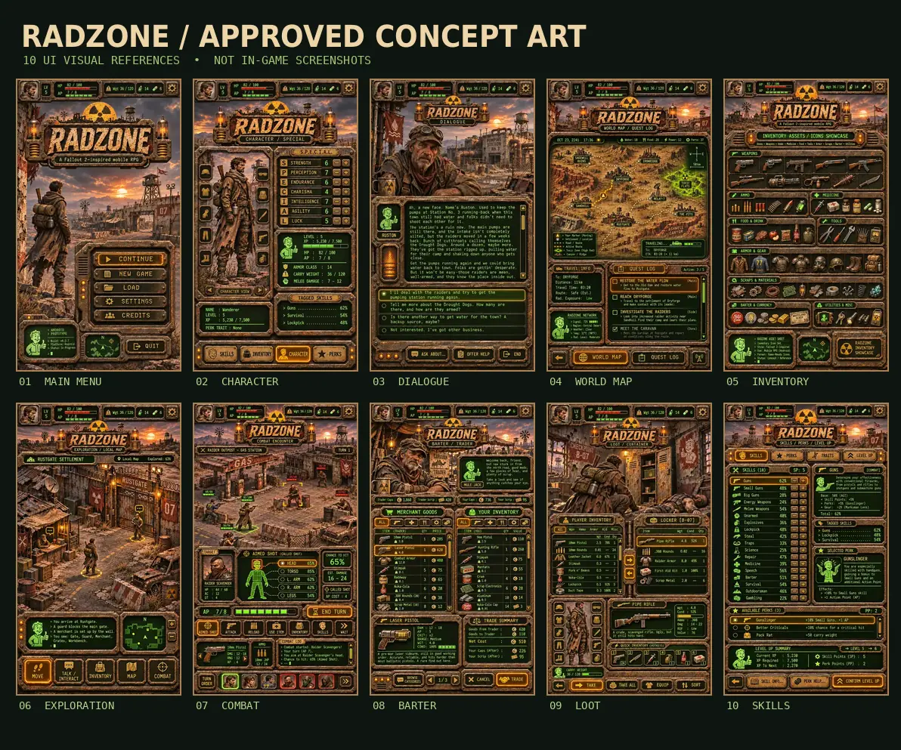</a>

<a href="./github-assets/approved/v2/01-main-menu.webp">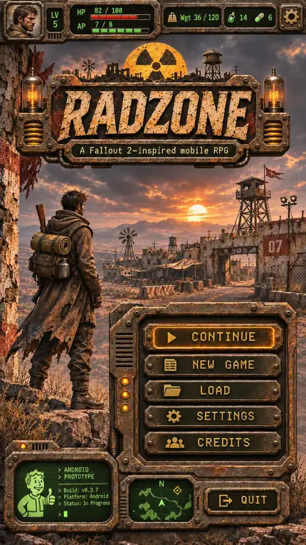</a>
<a href="./github-assets/approved/v2/02-character-special.webp">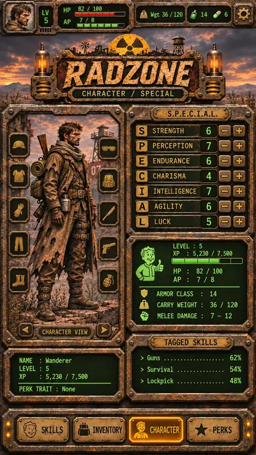</a>
<a href="./github-assets/approved/v2/03-dialogue.webp">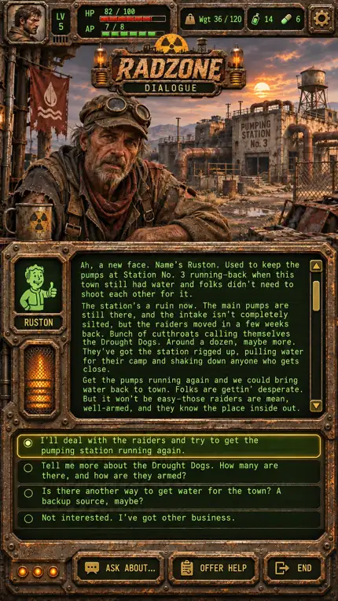</a>
<a href="./github-assets/approved/v2/04-world-map-quests.webp">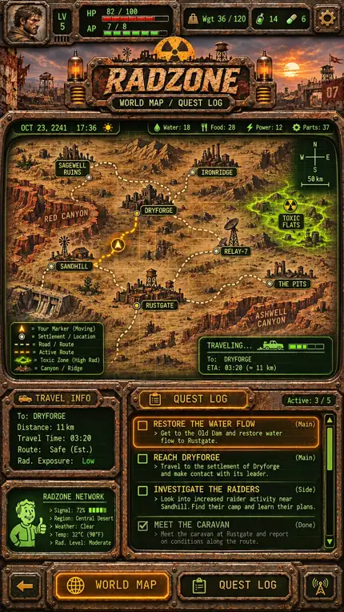</a>
<a href="./github-assets/approved/v2/05-inventory-icon-reference.webp">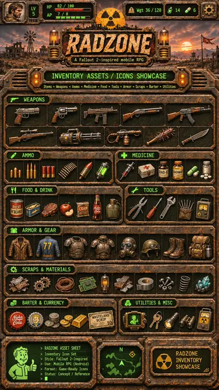</a>

<a href="./github-assets/approved/v2/06-exploration.webp">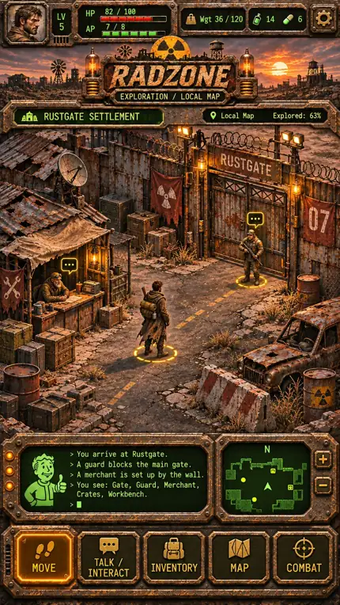</a>
<a href="./github-assets/approved/v2/07-tactical-combat.webp">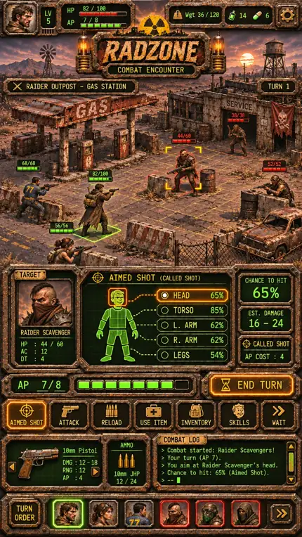</a>
<a href="./github-assets/approved/v2/08-barter.webp">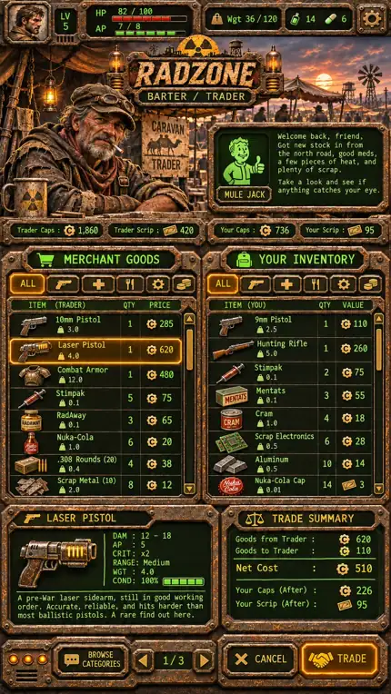</a>
<a href="./github-assets/approved/v2/09-loot-container.webp">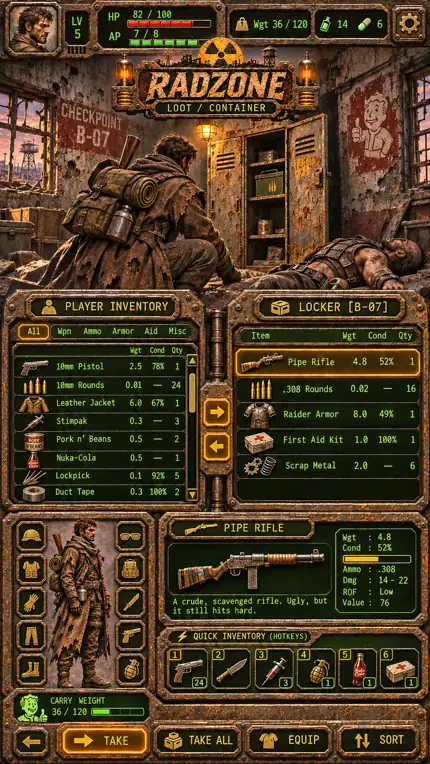</a>
<a href="./github-assets/approved/v2/10-skills-perks.webp">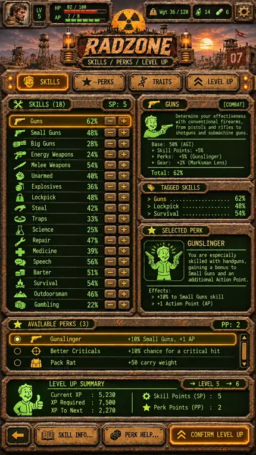</a>

> **Ces images sont des concepts visuels approuvés, PAS des captures d'une version Android jouable.**

## Équipement visible et PNJ variés

Les armes équipées doivent apparaître dans les mains ; armures, masques, casques et sacs doivent modifier l'apparence du personnage et des PNJ. Le jeu doit présenter des hommes, des femmes, des enfants, des personnes âgées et des communautés, professions, silhouettes et tenues variées. Ce sont des **exigences de production**, pas des fonctionnalités déjà livrées.

Les dialogues longs défilants, les caractères verts façon terminal et les panneaux métalliques vieillis sont au cœur de l'interface. Le prototype Godot est encore en développement.

## Development & documentation

- [Verified project state](./PROJECT_STATE.md) · [Fallout 2 fidelity matrix](./docs/FALLOUT2_FIDELITY_MATRIX.md)
- [Approved art catalog](./docs/art/APPROVED_VISUAL_CATALOG.md) · [RADZONE art direction](./docs/ART_DIRECTION_RADZONE.md)
- [Equipment and character-appearance specification](./docs/art/CHARACTER_EQUIPMENT_VISUAL_SPEC.md)
- [NPC variation matrix](./docs/art/NPC_VISUAL_DIVERSITY.md) · [OpenCode art integration handoff](./docs/art/OPENCODE_ART_HANDOFF.md)
- [Art pipeline](./docs/art/ART_PRODUCTION_WORKFLOW.md) · [Recovery guide](./docs/RECOVERY_GUIDE.md)

For development, clone `https://github.com/rf24kja/Fallout-mobile.git` and open `project.godot` in the project's Godot version. Engine work and build tests are carried out separately from this art branch.

**Independent fan-oriented project.** RADZONE is inspired by Fallout 2; it is not an official Fallout product. Original commercial game archives are not distributed here.
