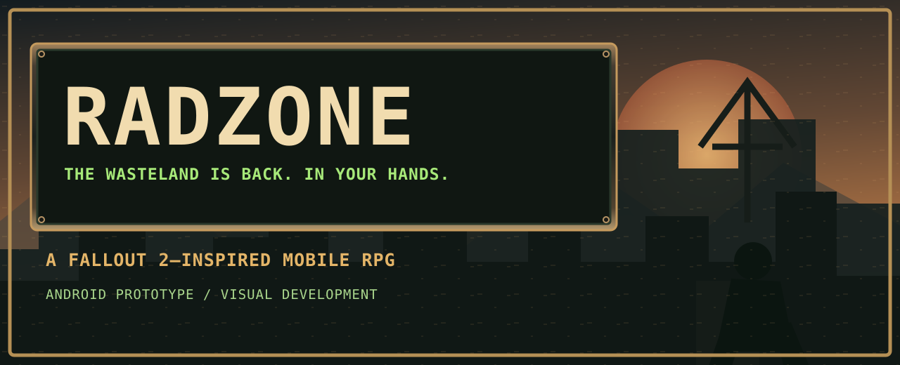
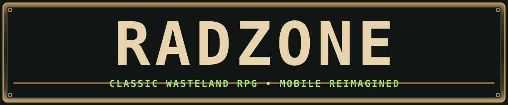
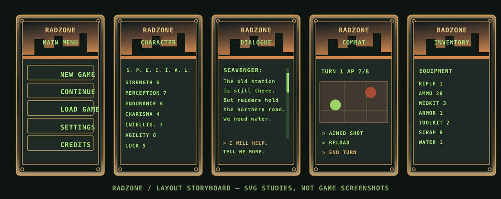

<p align="center"></p>
<p align="center"></p>
<p align="center">[EN](./README.md) · [RU](./README.ru.md) · [ES](./README.es.md) · [DE](./README.de.md) · [FR](./README.fr.md)</p>
<p align="center">   </p>
# RADZONE
**Old-school soul. Modern wasteland. Built for Fallout 2 fans.**

**RADZONE** is an independently developed, post-apocalyptic **mobile role-playing game in the spirit and style of Fallout 2**. We aim to preserve the depth and familiar feel of classic isometric RPGs while rebuilding graphics, interaction and presentation for phones.

## The visual identity
<p align="center"></p>
This **vector storyboard illustrates interface structure**, not completed gameplay and not the ten approved cinematic concept artworks. RADZONE's approved artwork has a distinctive language: rich realistic wasteland environments, distressed riveted steel, bronze mechanical buttons, amber signal lamps and glowing green CRT terminal text.

Our screens emphasize **scrollable long-form dialogue, SPECIAL and skills, accurate action-point feedback, called shots, equipment, world travel and trading** — the things old Fallout 2 fans recognize immediately.

## Approved ten-screen art library
The approved high-resolution PNG artwork and optimized WebP previews are organized for import into the repository; these large binary files are **not yet in this branch**. No broken image links are presented as uploads.

| Concept | Visual target |
|---|---|
| 01 — Main Menu | RADZONE branding and mechanical menu |
| 02 — Character / SPECIAL | Character equipment and all seven SPECIAL attributes |
| 03 — Dialogue | Long-scrollable phosphor-green NPC conversations |
| 04 — World Map / Quests | World travel, quests and navigation |
| 05 — Inventory Item Concepts | Weapons, ammunition, equipment and supplies |
| 06 — Exploration | Detailed isometric environment and touch actions |
| 07 — Tactical Combat | AP indicators, aimed shots and combat log |
| 08 — Barter | Trader inventory and exchange |
| 09 — Loot / Container | Item transfer and equipment |
| 10 — Skills / Perks | Classic character progression panels |

> **Art accuracy:** These are design concepts, **not screenshots of a playable version**. Mockup numbers, items, quests, character stats and effects are examples only, not gameplay specifications.

## Current development

| Area | Verified position |
|---|---|
| Godot project | Existing Godot 4.7.2 source published |
| Android | Prototype/debug development, no public stable release |
| Classic RPG fidelity | Implementation and comparison against Fallout 2 ongoing |
| RADZONE visual direction | Approved |
| Art integration | UI controls and production assets still in progress |

## Work with us
OpenCode handles gameplay code, tests, engine scenes and Android integration. The RADZONE visual workstream supplies artwork and modular original textures for that integration. [Browse project code and milestones](./PROJECT_STATE.md) · [Approved visual direction](./docs/ART_DIRECTION_RADZONE.md) · [Integration instructions](./docs/RADZONE_OPENCODE_HANDOFF.md).

### Developer entry point
```bash
git clone https://github.com/rf24kja/Fallout-mobile.git
# Open project.godot in Godot 4.7.2
```

**RADZONE** replaces the earlier development title *Fallout 2 Reborn Mobile*. Internal engine identifiers will be migrated separately with regression tests. This is an independent fan-oriented project and is not presented as an official Fallout game. Original commercial game data is not bundled in this repository.
