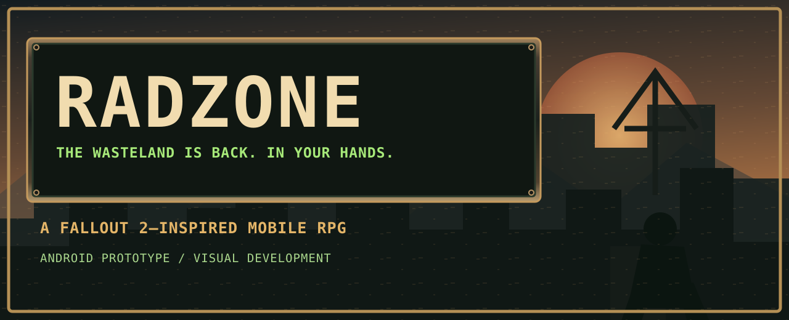
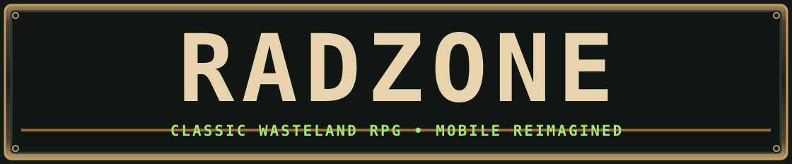
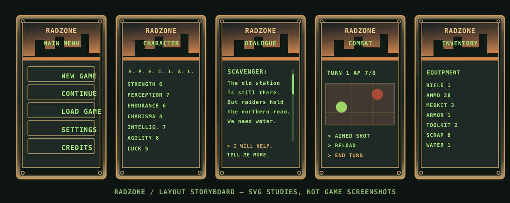

[EN](./README.md) · [RU](./README.ru.md) · [ES](./README.es.md) · [DE](./README.de.md) · [FR](./README.fr.md)

   

# RADZONE
**Душа классической RPG. Современная пустошь.**

**RADZONE** — мобильная постапокалиптическая RPG для поклонников **Fallout 2**. Сохраняем узнаваемые SPECIAL, пошаговые бои, очки действия, длинные диалоги и глубину ролевых систем. Переосмысляем графику и управление для смартфонов.

## Утверждённое визуальное направление

Утверждены реалистичная изометрическая пустошь, тяжёлые металлические панели, янтарные индикаторы и зелёный текст CRT-терминала. Старое название **REBORN MOBILE** заменено на **RADZONE**. Десять полноразмерных концептов подготовлены отдельно для загрузки; в GitHub пока опубликована векторная схема экранов.

> **Схема — векторная иллюстрация, не скриншот игры.** Полноразмерные концепты также не являются кадрами Android-сборки.

## Разработка

Текущая версия — Android-прототип на Godot 4.7.2. Механики проверяются по Fallout 2, а графические компоненты разрабатываются для последующей интеграции OpenCode.

[Art direction](./docs/ART_DIRECTION_RADZONE.md) · [Project state](./PROJECT_STATE.md) · [Asset handoff](./docs/RADZONE_OPENCODE_HANDOFF.md)

`git clone https://github.com/rf24kja/Fallout-mobile.git`
