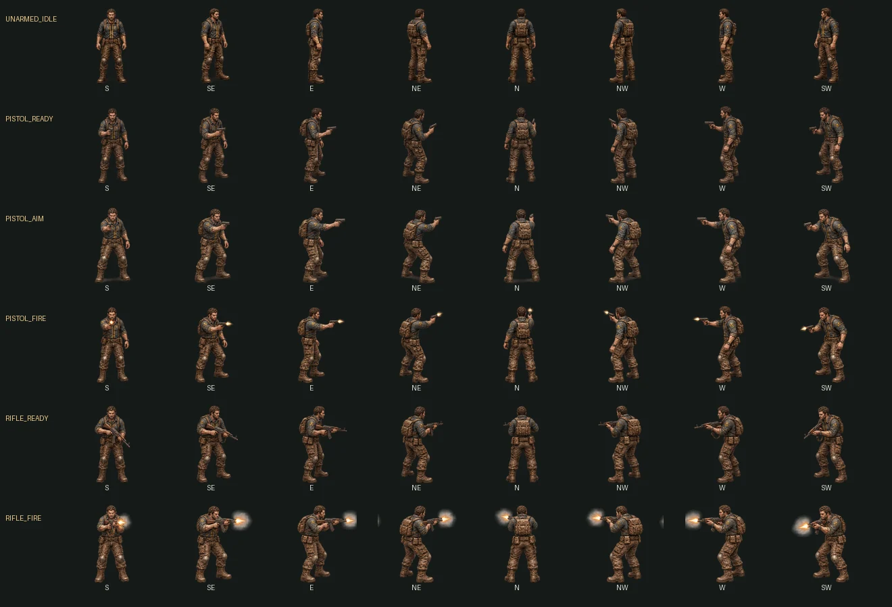
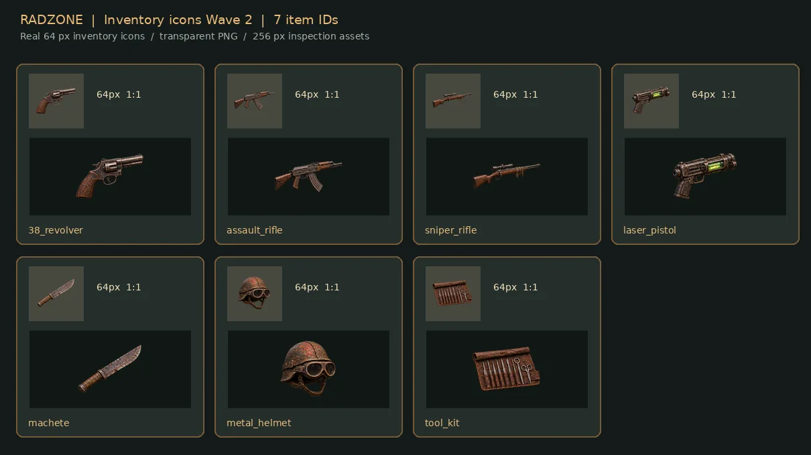

<!-- RADZONE GitHub Showcase v4 — maintained visual presentation. Approved art ≠ in-game captures. -->

<strong>独立开发的末日废土手机角色扮演游戏</strong>

<h1>RADZONE</h1>

<h2>废土归来。你的选择将留下痕迹。</h2>

经典 RPG 的深度、回合制战术的抉择，以及掌中的末日世界。

<a href="./README.md">English</a> &nbsp;│&nbsp; <a href="./README.ru.md">Русский</a> &nbsp;│&nbsp; <a href="./README.es.md">Español</a> &nbsp;│&nbsp; <a href="./README.de.md">Deutsch</a> &nbsp;│&nbsp; <a href="./README.fr.md">Français</a> &nbsp;│&nbsp; <a href="./README.zh-CN.md">简体中文</a> &nbsp;│&nbsp; <a href="./README.uk.md">Українська</a> &nbsp;│&nbsp; <a href="./README.th.md">ไทย</a>

<code>开发中</code> &nbsp;·&nbsp; <code>GODOT 4.7.2</code> &nbsp;·&nbsp; <code>ANDROID 原型</code>

◈ 已确认的美术概念图 — 并非游戏实机截图 ◈

<a href="#world">探索世界</a> &nbsp;·&nbsp; <a href="#character">角色成长</a> &nbsp;·&nbsp; <a href="#survival">生存与交易</a> &nbsp;·&nbsp; <a href="#development">开发进度</a>

---

## 找回经典 RPG 的核心

RADZONE 是受 Fallout 2 启发、独立开发的手机 RPG。我们希望保留经典作品的魅力：**有分量的选择、SPECIAL 角色成长、回合制战术战斗、重要的装备管理以及值得细读的对话**。

我们不只是把电脑界面缩小到手机上，而是努力将深度玩法带入适合 Android 横屏与触控操作的原创电影感废土世界。

## 01 / 走进废墟

### 这是一片值得探索的世界，而不只是一张地图。

被遗忘的聚落、危险的道路、任务与声望，都应让旅程更有意义。**等距视角场景、世界地图与环境叙事**是重要的设计方向。

## 02 / 塑造角色。承担后果。

### SPECIAL 远不止七个字母。

属性、技能、特长、经验和装备决定角色如何生存。我们希望在保留复杂 RPG 机制的同时，让它们在手机屏幕上清晰易用。

## 03 / 每一发子弹。每一笔交易。

### 废土不会平白给予任何东西。

搜寻容器、管理稀缺物资、以物易物，并慎重考虑每场战斗。装备属性与游戏数值应来自**真实的 Godot 游戏系统**，而非直接画在概念图上。

## 04 / 开火前先思考

行动点数、部位瞄准、伤害抗性和战术站位均属于玩法开发范围。可见的武器和装甲是重点，**但仍未完成实机整合**。

## 05 / 对话也会改变命运

长篇可滚动对话和分支选项是经典 RPG 的灵魂。绿色 CRT 文字、旧金属界面与现代触控体验需要相互配合。

---

## 官方确认的美术方向

这 **10 张已确认的图片**定义了美术目标。它们是概念图，**不是可运行 Android 游戏的截图**。

<a href="./docs/art/APPROVED_VISUAL_CATALOG.md"><strong>◈ 查看完整概念图库 ◈</strong></a>

## 从概念走向游戏资源

项目正在制作透明 PNG 道具、八方向角色姿势、图集、Godot 测试场景和独立战斗特效。**暂存资源不代表已通过游戏内测试。**

开发中的资源 / 尚未通过游戏内验证

<a href="https://github.com/rf24kja/Fallout-mobile/pull/28"><strong>⚙ 查看美术制作 PR</strong></a>

## 真实的项目状态

目前已有正在开发的 Godot/Android 原型。展示图代表目标品质；**尚未公布正式公开发行日期**。

| | |
|:--|:--|
| **Android / Godot** | 开发中的原型；文档记录 Godot 4.7.2 |
| **RPG 系统** | 正在验证与整合 |
| **美术方向** | 10 张已确认的概念图 |
| **制作资源** | 暂存候选资源；需要游戏内验证 |
| **公开发布** | 尚未公布 |

## 开发与源代码

欢迎查看项目状态、视觉规范、技术文档与开发记录。

**[浏览代码仓库](https://github.com/rf24kja/Fallout-mobile)** &nbsp;·&nbsp; [项目状态](./PROJECT_STATE.md) &nbsp;·&nbsp; [装备系统规范](./docs/art/CHARACTER_EQUIPMENT_VISUAL_SPEC.md) &nbsp;·&nbsp; [RPG 机制对照表](./docs/FALLOUT2_FIDELITY_MATRIX.md)

📂 技术文档

- [Approved visual direction](./docs/ART_DIRECTION_RADZONE.md)
- [Approved art catalog](./docs/art/APPROVED_VISUAL_CATALOG.md)
- [Character and equipment graphics](./docs/art/CHARACTER_EQUIPMENT_VISUAL_SPEC.md)
- [NPC appearance diversity](./docs/art/NPC_VISUAL_DIVERSITY.md)
- [Art production workflow](./docs/art/ART_PRODUCTION_WORKFLOW.md)
- [OpenCode development handoff](./docs/art/OPENCODE_ART_HANDOFF.md)
- [Recovery guide](./docs/RECOVERY_GUIDE.md)

---

### 关注开发进度

欢迎为仓库点 Star 并开启 Watch，及时了解进展。我们尚未承诺发布日期。

<strong>RADZONE</strong> &nbsp;·&nbsp; <a href="https://github.com/rf24kja/Fallout-mobile">github.com/rf24kja/Fallout-mobile</a>

本项目为独立开发、受经典 RPG 启发的作品，与 Bethesda、Interplay 或 Fallout 权利人无关联；不分发原版商业游戏资源。

