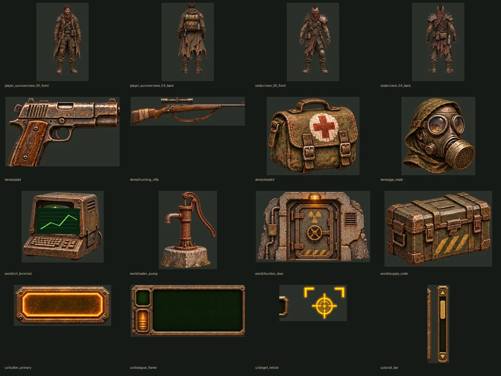

# RADZONE — Painterly Character, Item, Environment & UI Draft Pack v3.1

**Classification: DRAFT / FOR VISUAL REVIEW.** This is a game-art **source** library, **not** the published approved concept gallery and not footage from Godot. **Nothing here is approved for automatic scene replacement.**

## Catalog

| Group | Folder | Files | Status |
|---|---|---:|---|
| Player survivor | [characters/player_survivor/](./characters/player_survivor/) | 8 | Static turnaround reference views only |
| Raider | [characters/raider/](./characters/raider/) | 8 | Static turnaround reference views only |
| Inventory objects | [items/](./items/) | 15 | Isolated art; no verified game item IDs |
| World props | [world/](./world/) | 14 | Isolated art; perspective/scale not calibrated |
| Retro UI | [ui/](./ui/) | 13 | Components; needs trim, nine-slice and click-state QA |
| **Total** | | **58** | **Draft sources, not verified in-game** |

### Source sheets and visual review

Source concept sheets (high-quality WebP) and a contact sheet are at [draft references](../../../docs/art/reference/drafts/v3/). These are useful for reworking individual art to the final RADZONE quality target.

## Engine integration rules for OpenCode

1. The **10 user-approved cinematic UI concept screens** in [approved visual catalog](../../../docs/art/APPROVED_VISUAL_CATALOG.md) are the public-facing art target. This draft pack does not supersede them.
2. The real Godot character system is [CharacterVisual](../../../scripts/entities/character_visual.gd). It has base, body armor, head armor, hands, feet, eyes and weapon layers. Use it as the integration starting point; don't replace it with flat full-body images without preserving equipment overlays.
3. The 8 view names are **human-readable sheet views**, not verified engine directions. Validate orientation against the project direction convention before building SpriteFrames.
4. Inventory icons are **not weapon-in-hand sprites**. A pistol equipped by the player must have a correctly anchored world sprite, animation pose and occlusion for all directions.
5. Armor, clothing, helmet and backpack changes must visibly update the character and equipped NPCs. One blanket armor-tier recolor is insufficient when items have distinct appearances.
6. Every UI label, AP amount and dialogue line must remain a dynamic Godot Control. No image should bake in game state or replace a scrollable dialogue implementation.
7. Raster crops may contain edge/alpha noise from multi-object generated sheets. Perform **art cleanup and human inspection** of each before runtime integration.
8. Keep the existing live game assets and engine functionality intact until Godot + Android testing confirms a candidate.

## Reference docs

- [Approval and style catalog](../../../docs/art/APPROVED_VISUAL_CATALOG.md)
- [Equipment visual contract](../../../docs/art/CHARACTER_EQUIPMENT_VISUAL_SPEC.md)
- [NPC population diversity requirements](../../../docs/art/NPC_VISUAL_DIVERSITY.md)
- [OpenCode art integration handoff](../../../docs/art/OPENCODE_ART_HANDOFF.md)
- [Machine-readable manifest with SHA256/dimensions](./RADZONE_GITHUB_MANIFEST.json)

## Known limitations

Character views (8 per rig) are **not** a complete animated 8-direction set. Item crops are not linked to authoritative Fallout 2 item IDs. Environment assets do not include collision or sorting. UI crops need 9-slice QA and some are cut from a single painterly illustration. These limitations should remain visible in review and issues until addressed.