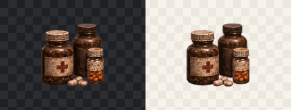

# RADZONE — Wave 08: medicine bottle loot icon (draft)

This small package contains **one** previously unregistered medicine-bottle group illustration, separated from the owner's supplied approved-style source sheet. It is not a newly AI-generated picture and is not certified for runtime use.

- Full native transparent **RGBA PNG**, 96×98 px, color type 6.
- No lore logos, characters, Nuka-Cola or UI trade dress.
- No gameplay, inventory balance, Godot or Android code changes.
- Art source sheet and original 160×164 RGBA extraction remain outside the Git repository; the source hash and crop coordinates are recorded in `manifest.json`.
- Medicine bottles as **loot prop** are semantically distinct from the registered first-aid kit and medical cabinet; they have no assigned canonical gameplay item ID.

For automatic checks, run:

```bash
python tools/art_check_duplicates.py art/production/painterly_v4/wave08/manifest.json
python tools/art_visual_duplicate_gate.py art/production/painterly_v4/wave08/manifest.json
```

## Remaining gates

Manual 100% edge/perspective review; full-resolution source archival; mapping to valid gameplay item if needed; OpenCode Godot import and Android capture. Do not call this production- or device-approved yet.

## Two-background alpha review

Left: near-black checkerboard. Right: ivory checkerboard. Both show the **same actual RGBA PNG** (not an edited rendering).


