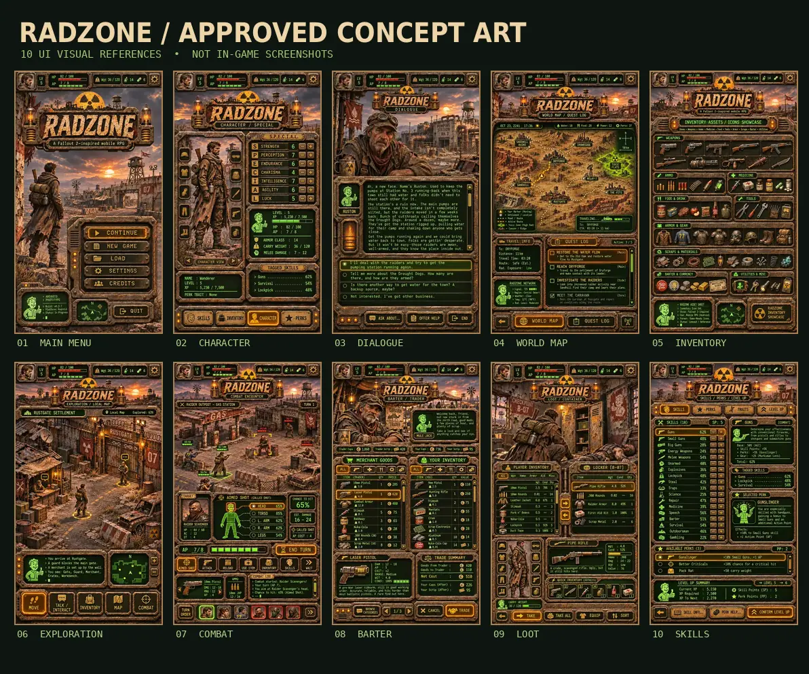

# RADZONE — Approved Visual Catalog

**Status:** User-approved concept art (2026-11-09), replacing all previous public design studies. **Brand:** RADZONE.

The images below are high-resolution image-generation **concepts**, not frames captured from an Android build. In-game screenshots will be published only under `screenshots/actual/` after real runtime validation.

## Approved concepts (click to view)

1. [01-main-menu](../../github-assets/approved/v2/01-main-menu.webp) — visual target; not a production-ready sprite.
2. [02-character-special](../../github-assets/approved/v2/02-character-special.webp) — visual target; not a production-ready sprite.
3. [03-dialogue](../../github-assets/approved/v2/03-dialogue.webp) — visual target; not a production-ready sprite.
4. [04-world-map-quests](../../github-assets/approved/v2/04-world-map-quests.webp) — visual target; not a production-ready sprite.
5. [05-inventory-icon-reference](../../github-assets/approved/v2/05-inventory-icon-reference.webp) — visual target; not a production-ready sprite.
6. [06-exploration](../../github-assets/approved/v2/06-exploration.webp) — visual target; not a production-ready sprite.
7. [07-tactical-combat](../../github-assets/approved/v2/07-tactical-combat.webp) — visual target; not a production-ready sprite.
8. [08-barter](../../github-assets/approved/v2/08-barter.webp) — visual target; not a production-ready sprite.
9. [09-loot-container](../../github-assets/approved/v2/09-loot-container.webp) — visual target; not a production-ready sprite.
10. [10-skills-perks](../../github-assets/approved/v2/10-skills-perks.webp) — visual target; not a production-ready sprite.

## Hierarchy of art sources

- `github-assets/approved/v2/`: compressed, approved public concept previews used on the repository landing page.
- `docs/art/reference/RADZONE_APPROVED_v2/`: original 941×1672 PNG concept masters are preserved in the approved v2 archive; **not all masters have been uploaded to GitHub**.
- `docs/art/reference/drafts/`: in-development 8-direction turnarounds and painterly props, **not user-approved production sprites**.
- `art/production/`: technical source components and drafts, **not automatically approved visual assets**.
- `screenshots/actual/`: real Godot/Android capture only.

**Public showcase rule:** Do not display placeholder flat SVG icons, storyboard diagrams or draft assets on the README front page as the game's look. The approved concepts are the visual direction; show them honestly as concepts.

## Review criteria

1. Reproduce the approved gritty cinematic materials and recognizable Fallout 2-inspired UI design without relying on schematic vector placeholders as final art.
2. Preserve readable long-form scrolling dialogue, tactile controls and actual game-state presentation.
3. Equipment visibly changes the character, with weapons placed in hands for every direction and animation.
4. Distinct NPC designs, genders, age groups, phenotypes, clothing and silhouettes, consistent across animation frames.
5. Maintain artistically consistent perspective, lighting, ground anchors and alpha.
6. Every released asset has a provenance record, source file, dimensions, version, stable name, export size and QA status.

The original source PNGs can be imported from the prepared `RADZONE_Visual_Development_v2_2026-11-09.zip` without regenerating them.
