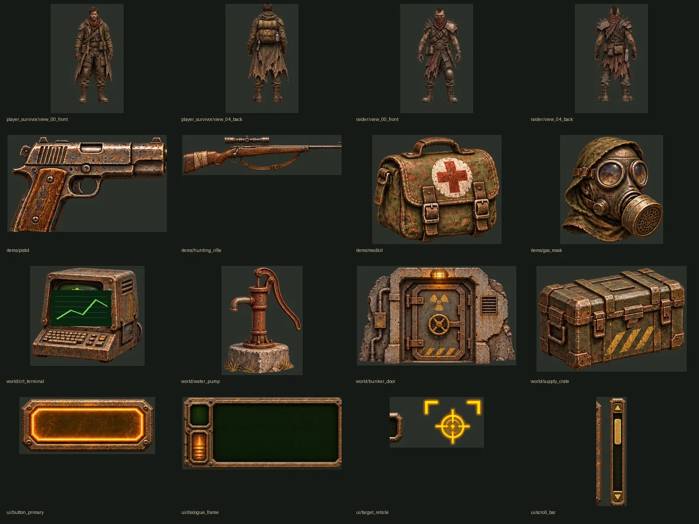

# Painterly v3 — source-sheet gallery (DRAFT)

The five sheets below are **unapproved work-in-progress references**, not the official RADZONE visual showcase and not real game screenshots. The 58 isolated transparent PNG sources are under [art/production/painterly_v3/](../../../../../art/production/painterly_v3/).

## Original sheet references

- [Player survivor turnaround](./source_sheet_characters_player_survivor.webp)
- [Raider turnaround](./source_sheet_characters_raider.webp)
- [Equipment and consumables](./source_sheet_items.webp)
- [World objects](./source_sheet_world.webp)
- [Retro CRPG interface](./source_sheet_ui.webp)

Some elements have cutout artifacts, proportions that change across views or unmatched isometric perspective. These have not yet passed per-frame sprite QA. `view_00_front` etc are sheet-view labels, not Godot engine direction names; animation and weapon/armor layers remain to be designed.

The **10 approved cinematic concept screens** are separately available in [Approved Visual Catalog](../../../APPROVED_VISUAL_CATALOG.md). Do not replace them on the main README with this draft sheet.

For handoff read [Game Art Production README](../../../../../art/production/painterly_v3/README.md), [Equipment Contract](../../../CHARACTER_EQUIPMENT_VISUAL_SPEC.md), and [NPC Diversity](../../../NPC_VISUAL_DIVERSITY.md).
